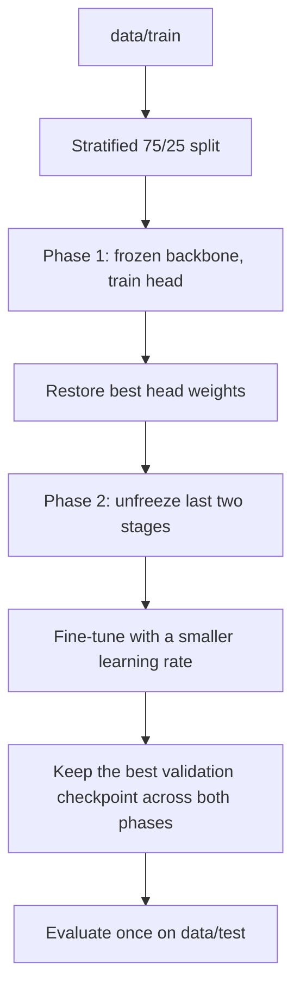
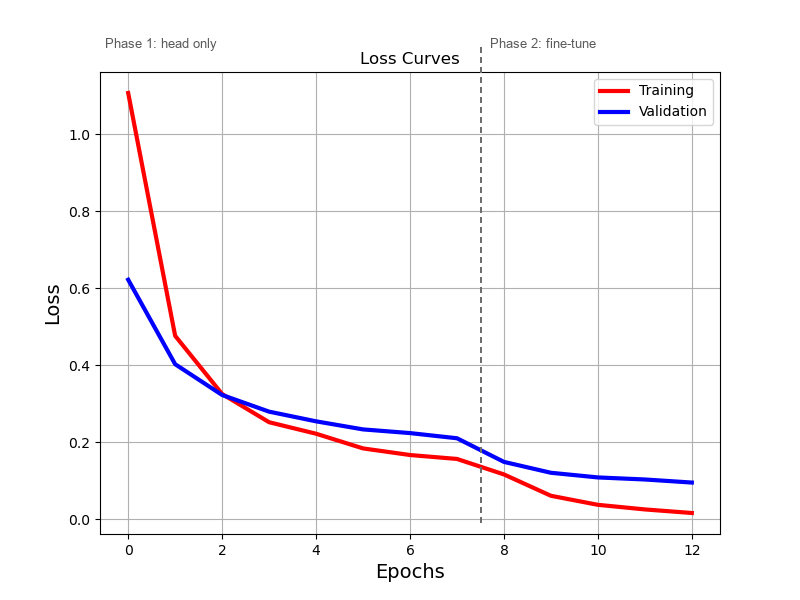
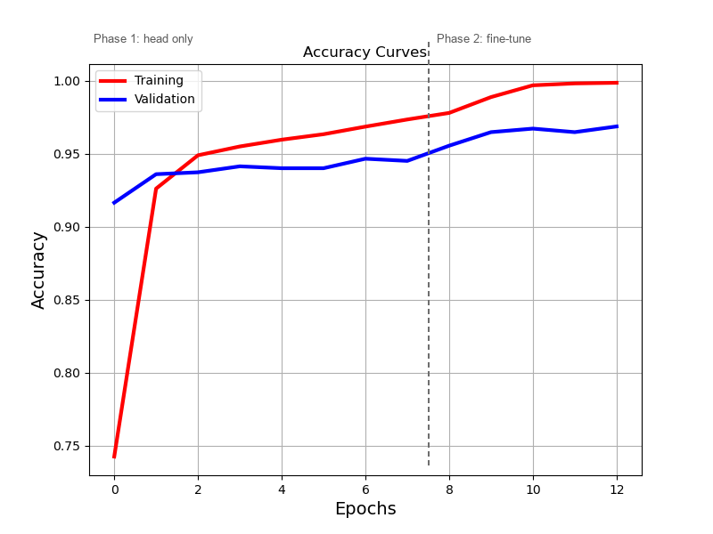

# CNN for Visual Recognition

**Landmark classification with two-phase transfer learning**


A PyTorch + [timm](https://github.com/huggingface/pytorch-image-models) image
classifier that recognizes six world landmarks from a single photo. The project
compares **MobileNetV3-Large** and **EfficientNet-Lite0**, uses a two-phase
fine-tuning recipe, evaluates on a deliberately difficult Instagram-style test
set, and exports the final model to **ONNX** for CPU / Raspberry Pi inference.

> **Scope.** This repository contains the computer-vision / perception module
> only. Given an image, it returns a landmark label and a confidence score. It
> is self-contained and does not depend on a robotics simulator; it can be used
> as the vision block of a larger system such as a tour-guide robot or a mobile
> app. Robot control and simulation code are not part of this repository.

## Results at a glance

| Item | Value |
|---|---|
| Classes | 6 landmarks |
| Training images | 3,040 |
| Held-out test images | 95 Instagram-style screenshots |
| Selected model | `mobilenetv3_large_100.ra_in1k` |
| Test accuracy | **90 / 95 (94.7%)** |
| Macro recall | **93.9%** |
| Input | RGB, 3 × 224 × 224 |
| Deployment | ONNX Runtime on CPU / Raspberry Pi 4 |

<p align="center">
  
</p>

<p align="center">
  <em>MobileNetV3-Large on the held-out test set. Rows are true labels,
  columns are predictions.</em>
</p>

The model is perfect on four classes and finds Tokyo Tower hardest: its lattice
structure is visually close to the Eiffel Tower and to the steel towers of the
Golden Gate and Brooklyn bridges.

## What the model does

1. Takes one RGB image (a photo, a camera frame, or a screenshot).
2. Resizes the shorter side to 256 px, center-crops to 224 × 224, and normalizes
   with the statistics expected by the pretrained backbone.
3. Extracts a 1,280-dimensional feature vector with a MobileNetV3-Large
   backbone pretrained on ImageNet-1k.
4. Classifies that vector into six logits with a single linear layer.
5. Applies softmax and returns the most likely landmark plus its confidence.

The six classes are:

`Brooklyn_Bridge` · `Eiffel_Tower` · `Golden_Gate` · `Great_Wall` ·
`Sagrada_Familia` · `Tokio_Tower` (Tokyo Tower)

Example output from `landmark_classifier.predict`:

```text
photo.jpg
  prediction: Eiffel_Tower (99.42%)
  top-k: Eiffel_Tower 99.42% | Tokio_Tower 0.31% | Great_Wall 0.12%
```

## How it works

### Inference pipeline

```mermaid
flowchart LR
    A[Camera frame or image file] --> B[Convert to RGB]
    B --> C[Resize shorter side to 256]
    C --> D[Center crop to 224 x 224]
    D --> E[Normalize with backbone stats]
    E --> F[MobileNetV3-Large backbone]
    F --> G[1280-d feature vector]
    G --> H[Linear classifier]
    H --> I[6 logits]
    I --> J[Softmax: label + confidence]
```



### Two-phase training



| Phase | Backbone | Trainable parameters | Epochs | Learning rate |
|---|---|---|---|---|
| 1 — head only | Fully frozen | Linear head only | 8 | `1e-3` |
| 2 — partial fine-tuning | Last 2 stages + head | Last stages + head | 5 | `1e-4` |

Both phases use Adam, batch size 64 and cross-entropy loss. Training images are
augmented with random resized crops, horizontal flips and mild colour jitter.
The validation split is used for checkpoint selection; the test split is only
touched once, after training.

### Why two phases?

Training a deep CNN from scratch on ~3,000 images would overfit and waste the
ImageNet features. Freezing the backbone first lets the new head adapt without
destroying those features. A short second phase then adapts the last, most
task-specific stages with a 10× smaller learning rate. This is a practical
middle ground between a linear probe and full fine-tuning.

### Implementation details that matter

- **Stratified split** — every class is represented in train and validation.
- **Best phase-1 weights are restored** before phase 2, instead of continuing
  from the last epoch.
- **Best checkpoint across both phases** is kept, not merely the final epoch.
- **Frozen BatchNorm statistics** — `model.train()` is followed by a pass that
  puts BatchNorm layers of frozen blocks back into eval mode.
- **Model-specific preprocessing** — mean, std and input size come from
  `timm.data.resolve_model_data_config`, not hard-coded ImageNet values.
- **No softmax in the model** — `CrossEntropyLoss` expects logits; softmax is
  applied only at inference time.
- **Metadata in the checkpoint** — class names, preprocessing statistics and
  the model name travel with the weights, so prediction and ONNX export do not
  need the training script.

## Results

| Model | Correct | Accuracy | Macro recall | Macro F1 |
|---|---:|---:|---:|---:|
| **MobileNetV3-Large 100** (selected) | 90 / 95 | **94.7%** | **93.9%** | 94.1% |
| EfficientNet-Lite0 | 90 / 95 | 94.7% | 93.5% | 94.1% |

<p align="center">
  
</p>

Both backbones reach 90/95, but MobileNetV3-Large has better recall on the
hardest class (Tokyo Tower: 9/12 vs. 8/12) and was selected as the final model.
EfficientNet-Lite0 is slightly better on Brooklyn Bridge (16/17 vs. 15/17).

### Training curves

<p align="center">
  
</p>

<p align="center">
  
</p>

The dashed line marks the switch from head-only training to partial
fine-tuning. Validation accuracy ends around 96.7%, while test accuracy is
94.7% — a small and expected gap given the domain shift in the test set.

The full error analysis, including the EfficientNet confusion matrix, is in
[`docs/RESULTS.md`](docs/RESULTS.md).

## Repository structure

```text
CNN_for_VisualRecognition/
├── landmark_classifier/
│   ├── data.py              # transforms, stratified split, dataloaders
│   ├── model.py             # timm backbone + linear head, freeze/unfreeze
│   ├── engine.py            # training loop, validation, metrics
│   ├── train.py             # two-phase training CLI
│   ├── evaluate.py          # evaluate a checkpoint on data/test
│   ├── predict.py           # single image / folder inference
│   ├── export_onnx.py       # ONNX export with preprocessing metadata
│   ├── checkpoint.py        # save/load/rebuild a model
│   ├── reporting.py         # metrics JSON, CSV, classification report
│   ├── plots.py             # confusion matrix, curves, prediction grid
│   └── utils.py             # seeding, device, JSON helpers
├── deploy/
│   └── onnx_inference.py    # PyTorch-free CPU / Raspberry Pi inference
├── docs/
│   ├── PIPELINE.md          # detailed method and design decisions
│   ├── RESULTS.md           # metrics, error analysis, limitations
│   ├── DEPLOYMENT.md        # ONNX + Raspberry Pi workflow
│   └── images/              # result figures (no personal images)
├── results/                 # recorded confusion matrices and notes
├── scripts/
│   └── plot_results.py      # regenerate result figures
├── data/README.md           # expected layout; dataset is not included
├── requirements.txt
├── requirements-deploy.txt
├── pyproject.toml
├── LICENSE
└── CONTEXT.md               # curation notes for this portfolio repository
```

## Quick start

### 1. Install

```bash
git clone https://github.com/sejotta/CNN_for_VisualRecognition.git
cd CNN_for_VisualRecognition

python -m venv .venv
# Windows
.venv\Scripts\activate
# Linux / macOS
source .venv/bin/activate

pip install -r requirements.txt
# optional: install the package and its console scripts
pip install -e . --no-deps
```

For CUDA, install the PyTorch build that matches your driver from
[pytorch.org](https://pytorch.org/get-started/locally/), then install the
remaining requirements.

### 2. Add the data

The dataset is **not included** (size, copyright and privacy). It expects:

```text
data/train/<class_name>/*.jpg
data/test/<class_name>/*.jpg
```

See [`data/README.md`](data/README.md) for the original class counts and the
reason the images are excluded.

### 3. Train

```bash
python -m landmark_classifier.train \
  --data-dir data \
  --output-dir runs/mobilenetv3_large100
```

Useful options:

```bash
--model tf_efficientnet_lite0.in1k   # compare another timm backbone
--epochs-head 8 --epochs-finetune 5
--lr-head 1e-3 --lr-finetune 1e-4
--batch-size 64 --val-fraction 0.25
--unfreeze-blocks 2
--patience 3                         # optional early stopping per phase
--device cuda                        # or cpu, mps, auto
```

Outputs in `--output-dir`:

| File | Contents |
|---|---|
| `best.pt` | weights + class names + preprocessing + config |
| `history.json` | per-epoch losses and accuracies |
| `config.json` | exact CLI configuration |
| `training_curves.png` | loss / accuracy curves with the phase boundary |
| `test_metrics.json` | accuracy, macro F1, per-class metrics, matrix |
| `test_confusion_matrix.png` | confusion matrix |
| `test_classification_report.txt` | precision / recall / F1 per class |
| `test_predictions.csv` | one row per test image |

### 4. Evaluate

```bash
python -m landmark_classifier.evaluate \
  --checkpoint runs/mobilenetv3_large100/best.pt \
  --data-dir data \
  --output-dir runs/mobilenetv3_large100/eval
```

### 5. Predict

```bash
python -m landmark_classifier.predict \
  --checkpoint runs/mobilenetv3_large100/best.pt \
  --input path/to/photo.jpg \
  --topk 3
```

For a folder, add `--labels-from-folders` to compare against folder names and
`--save-grid predictions.png` to write a visual grid:

```bash
python -m landmark_classifier.predict \
  --checkpoint runs/mobilenetv3_large100/best.pt \
  --input data/test \
  --labels-from-folders \
  --save-grid predictions.png \
  --output-json predictions.json
```

### 6. Export to ONNX and run on CPU / Raspberry Pi

```bash
pip install -r requirements-deploy.txt

python -m landmark_classifier.export_onnx \
  --checkpoint runs/mobilenetv3_large100/best.pt \
  --output exports/landmarks.onnx

python deploy/onnx_inference.py \
  --model exports/landmarks.onnx \
  --image path/to/photo.jpg
```

The ONNX file carries its class names and normalization statistics, so the
deployment script needs only `onnxruntime`, NumPy and Pillow. See
[`docs/DEPLOYMENT.md`](docs/DEPLOYMENT.md) for the complete workflow.

## Design decisions

- **Transfer learning instead of training from scratch.** With ~3,000 images,
  ImageNet features are far more valuable than randomly initialized filters.
- **Head-first, then partial fine-tuning.** The head adapts quickly; the small
  second phase adapts the most task-specific stages without catastrophic
  forgetting.
- **Stratified split.** A purely random split can leave a class poorly
  represented in validation; stratification keeps the estimate stable.
- **Validation-loss checkpointing.** The final model is the best validation
  checkpoint across both phases, not the last epoch.
- **Frozen BatchNorm in frozen blocks.** Prevents running statistics from
  drifting while a block is not being trained.
- **Model-specific normalization.** The preprocessing contract comes from timm,
  so changing the backbone does not silently break accuracy.
- **Augmentation matched to the task.** Random crops, flips and mild colour
  jitter reflect the variety of real photos without turning the task into a
  different one.
- **Two backbones, one recipe.** The same code trains MobileNetV3 and
  EfficientNet-Lite0, making the comparison fair.
- **Deployment-aware export.** ONNX metadata makes the CPU/Raspberry Pi path
  reproducible and hard to misuse.

## Reproducibility

- Default seed: `42`; the train/validation split is stratified and seeded.
- The exact configuration is written to `config.json` and embedded in
  `best.pt`.
- GPU training is not bit-for-bit deterministic; small metric differences on
  retraining are expected.
- The reported figures come from recorded confusion matrices in `results/`.
  Re-running the training script may therefore produce slightly different
  numbers.

## Limitations

- **Small test set.** 95 images means one error changes accuracy by about
  1.05 percentage points; treat the 94.7% as an estimate, not a precise
  guarantee.
- **Scraped data.** Web images bring label noise, duplicates and uneven
  difficulty. The dataset was manually organised, but it is not a curated
  benchmark.
- **Domain shift.** The test set is Instagram-style: people, text overlays,
  filters, crops and unusual viewpoints. This is intentional, but it makes the
  test harder than the training distribution.
- **Closed-world classifier.** The model always returns one of the six classes;
  it has no "unknown" or out-of-distribution option.
- **No probability calibration.** Softmax confidence is not calibrated; do not
  read 99% as a guaranteed 99% success rate.
- **Perception only.** This repository does not include robot control,
  navigation or simulator code. It is the vision module that such a system
  could call.
- **No weights or images in the repository.** Both are excluded for size,
  copyright and privacy reasons; the training script regenerates the weights.

## License and academic acknowledgement

This project is released under the **Academic Portfolio License** — see
[`LICENSE`](LICENSE).

It was developed as the third practical assignment (P3) of the **Computer
Vision** course at the **Escuela de Ingeniería y Arquitectura (EINA),
Universidad de Zaragoza**. The project was supervised, corrected and guided by
the course professors. Their teaching, feedback and corrections made this work
possible; the academic credit for that guidance belongs to the Computer Vision
teaching team at EINA.

You are free to read, study, run and learn from this code. **If you reuse it in
another project, redistribute it, or use it commercially, you must request
permission from the author and from the Computer Vision teaching team, and you
must credit both.** Permission requests can be made through the repository's
[issues](https://github.com/sejotta/CNN_for_VisualRecognition/issues).

The images used to train and test the model are **not** covered by this
licence and are not distributed here.

## Citation

```bibtex
@misc{sejotta2026landmarks,
  author = {sejotta},
  title  = {CNN for Visual Recognition: Landmark Classification with Transfer Learning},
  year   = {2026},
  url    = {https://github.com/sejotta/CNN_for_VisualRecognition}
}
```

## Contact

Please use the repository's
[issues](https://github.com/sejotta/CNN_for_VisualRecognition/issues) for
questions, bug reports and permission requests.
