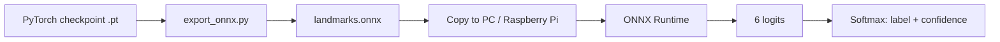

# Deployment: ONNX on CPU and Raspberry Pi

The training code uses PyTorch, but the trained model does not have to. The
final checkpoint can be exported to ONNX and executed with ONNX Runtime on a
normal CPU or on a Raspberry Pi 4. This is the lightweight inference path used
in the project's "low-cost GPU" annex.



## 1. Export on the training machine

```bash
pip install -r requirements-deploy.txt

python -m landmark_classifier.export_onnx \
  --checkpoint runs/mobilenetv3_large100/best.pt \
  --output exports/landmarks.onnx
```

The exporter:

- fixes the input to `float32 [batch, 3, 224, 224]`;
- exposes the output as `logits` with shape `[batch, 6]`;
- uses a dynamic batch axis so one or several images can be passed;
- verifies the ONNX output against PyTorch (when `onnxruntime` is installed);
- writes the class names, input size, mean and std into the ONNX metadata.

The metadata is important: it lets the deployment script preprocess images
exactly as the model was trained, without importing the training code.

## 2. ONNX contract

| Item | Value |
|---|---|
| Input name | `input` |
| Input shape | `[batch, 3, 224, 224]` |
| Input dtype | `float32` |
| Output name | `logits` |
| Output shape | `[batch, 6]` |
| Output meaning | unnormalized class scores |
| Class order | alphabetical: Brooklyn, Eiffel, Golden Gate, Great Wall, Sagrada Família, Tokyo Tower |
| Preprocessing | RGB, resize shorter side to 256, center crop 224, `(x - mean) / std` |

The output is **logits**, not probabilities. Apply softmax before interpreting
the scores as confidence.

## 3. Run on a PC

```bash
python deploy/onnx_inference.py \
  --model exports/landmarks.onnx \
  --image path/to/photo.jpg \
  --topk 3
```

For a folder:

```bash
python deploy/onnx_inference.py \
  --model exports/landmarks.onnx \
  --image path/to/folder
```

## 4. Run on a Raspberry Pi 4

Use a 64-bit Raspberry Pi OS for the smoothest ONNX Runtime installation.

```bash
# on the Pi
sudo apt update
sudo apt install -y python3-pip
pip3 install onnxruntime numpy pillow
```

Copy `landmarks.onnx` and `deploy/onnx_inference.py` to the Pi, then run:

```bash
python3 onnx_inference.py \
  --model landmarks.onnx \
  --image test_photo.jpg \
  --topk 3
```

The script does not import PyTorch, so the Pi does not need a PyTorch install.

## 5. Integrate it into a larger system

The inference loop is deliberately small:

```python
import onnxruntime as ort

session = ort.InferenceSession("landmarks.onnx", providers=["CPUExecutionProvider"])
input_name = session.get_inputs()[0].name
logits = session.run(None, {input_name: preprocessed_image})[0]
```

A robot or application can call this function with a camera frame and use the
returned label and confidence for a higher-level decision. This repository
stops at the perception layer: it does not contain navigation, control or
simulator code.

## 6. Performance notes

- **Measure, do not assume.** Latency depends on the Pi model, cooling, RAM,
  ONNX Runtime version and whether the CPU is throttling. No benchmark numbers
  are claimed here because they were not measured in a controlled way.
- **Batch size 1** is the typical robot case. The exported model accepts larger
  batches, but a Pi gains little from them.
- **Threads.** ONNX Runtime uses multiple CPU threads by default. On a Pi, cap
  the thread count if other processes need CPU time.
- **Quantization.** Dynamic INT8 quantization can reduce model size and improve
  CPU latency, but it can also change accuracy. Treat it as an experiment and
  re-evaluate on the test set before deploying.
- **Input pipeline.** Image decoding and resizing can cost as much as inference
  on a Pi; keep the camera resolution reasonable and reuse buffers where
  possible.

## 7. Troubleshooting

| Symptom | Likely cause |
|---|---|
| `Missing preprocessing metadata` | The ONNX file was not produced by `export_onnx.py` |
| Predictions look random | Wrong normalization, RGB/BGR swap, or class order mismatch |
| `onnxruntime` import fails on the Pi | 32-bit OS or missing wheel for the architecture; use 64-bit Raspberry Pi OS |
| Export fails with `onnx` import error | `pip install -r requirements-deploy.txt` on the training machine |
| ONNX verification difference > 1e-3 | Exported on an unsupported opset or a custom model; re-export with the default settings |
