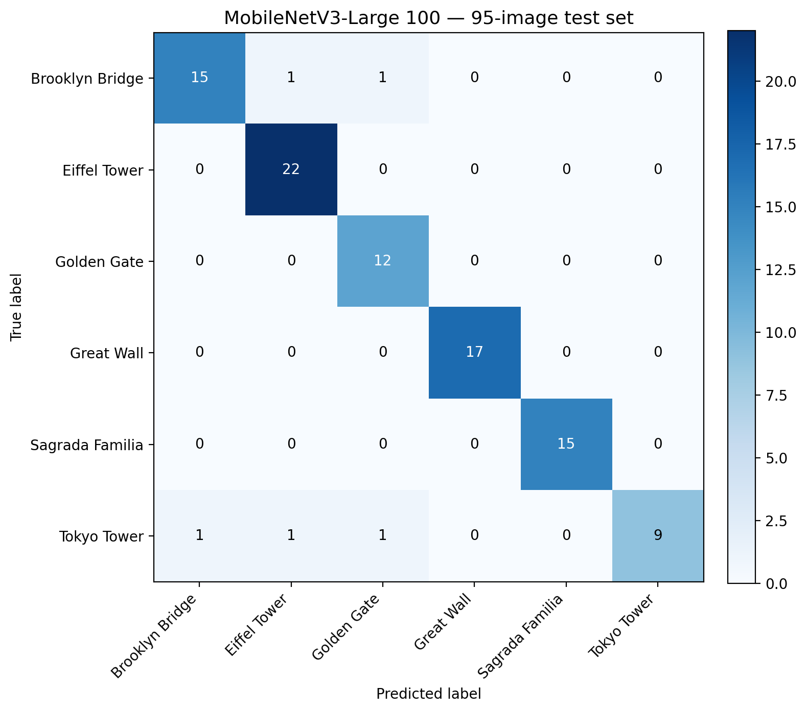
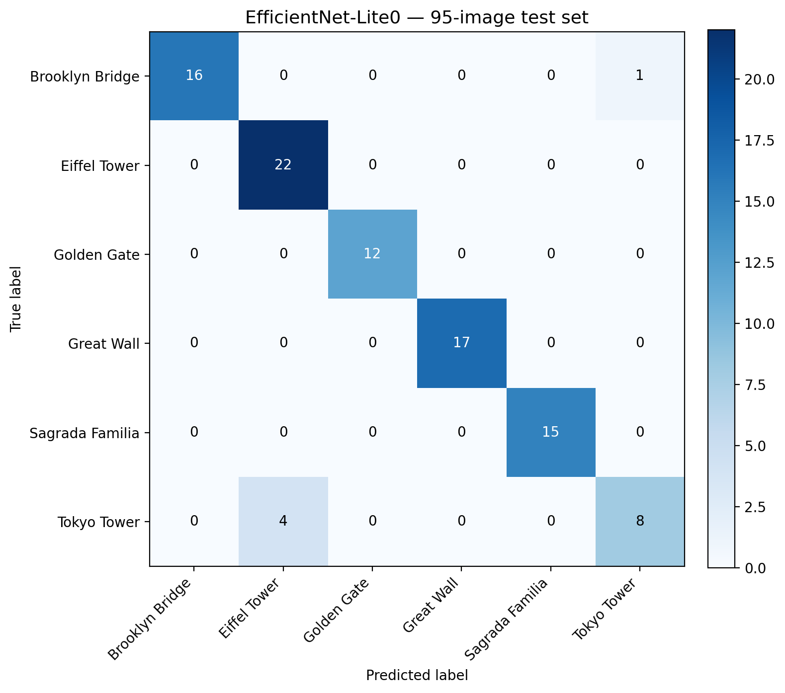
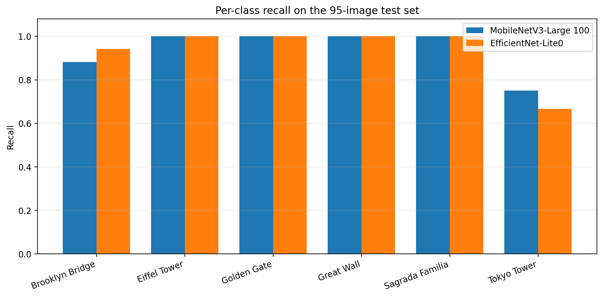

# Results and error analysis

## Headline numbers

| Model | Correct | Accuracy | Macro recall | Macro F1 |
|---|---:|---:|---:|---:|
| **MobileNetV3-Large 100** (selected) | 90 / 95 | **94.7%** | **93.9%** | 94.1% |
| EfficientNet-Lite0 | 90 / 95 | 94.7% | 93.5% | 94.1% |

Both models were trained with the same two-phase recipe and evaluated on the
same 95-image held-out test set. The difference between them is small; the
choice of MobileNetV3-Large is explained below.

## Confusion matrices

### MobileNetV3-Large 100

<p align="center">
  
</p>

### EfficientNet-Lite0

<p align="center">
  
</p>

Rows are true labels; columns are predictions. The diagonal contains correct
predictions.

## Per-class recall

| Class | MobileNetV3-Large | EfficientNet-Lite0 |
|---|---:|---:|
| Brooklyn Bridge | 15/17 (88.2%) | 16/17 (94.1%) |
| Eiffel Tower | 22/22 (100%) | 22/22 (100%) |
| Golden Gate | 12/12 (100%) | 12/12 (100%) |
| Great Wall | 17/17 (100%) | 17/17 (100%) |
| Sagrada Família | 15/15 (100%) | 15/15 (100%) |
| Tokyo Tower | 9/12 (75.0%) | 8/12 (66.7%) |

<p align="center">
  
</p>

Four classes are classified perfectly by both models. Tokyo Tower is clearly
the hardest class, and Brooklyn Bridge is the only other class with any errors.

## Error analysis

### MobileNetV3-Large (5 errors)

| True label | Predicted as | Count |
|---|---|---:|
| Brooklyn Bridge | Eiffel Tower | 1 |
| Brooklyn Bridge | Golden Gate | 1 |
| Tokyo Tower | Brooklyn Bridge | 1 |
| Tokyo Tower | Eiffel Tower | 1 |
| Tokyo Tower | Golden Gate | 1 |

### EfficientNet-Lite0 (5 errors)

| True label | Predicted as | Count |
|---|---|---:|
| Brooklyn Bridge | Tokyo Tower | 1 |
| Tokyo Tower | Eiffel Tower | 4 |

### Why Tokyo Tower is hard

Tokyo Tower and the Eiffel Tower share a lattice-tower silhouette. At night,
with strong red illumination or a tight crop, the structural difference between
the two is much less obvious. The Golden Gate and Brooklyn bridges also have
steel towers and suspension cables, so a cropped tower can resemble a bridge
tower. The Instagram-style test images add people, text, filters and unusual
angles, removing the skyline context that usually makes the landmark obvious.

The fact that both models confuse the same broad family of structures is a
useful signal: the remaining errors are semantic/visual ambiguity, not random
failures.

## Training dynamics

The training curves are shown in the README. The key observations:

- Phase 1 converges quickly: the linear head learns a useful boundary from
  frozen ImageNet features within a few epochs.
- Phase 2 lowers validation loss further with a 10× smaller learning rate.
- Final training accuracy is ~99.9% and validation accuracy ~96.7%, so there is
  a visible but moderate generalization gap.
- Test accuracy (94.7%) is slightly below validation accuracy, which is
  expected given the deliberate domain shift in the test set.
- No severe overfitting is visible in the curves: validation loss does not
  diverge while training loss collapses.

The phase boundary in the figures is between epoch 8 and epoch 9: eight
head-only epochs followed by five fine-tuning epochs.

## Model selection

Both models reach 90/95. The tie-break was:

1. **Macro recall:** 93.9% vs. 93.5% in favour of MobileNetV3-Large.
2. **Worst-class recall:** Tokyo Tower 9/12 vs. 8/12.
3. **Deployment:** MobileNetV3 is designed for mobile-class CPUs and has a
   simple block structure for partial fine-tuning.

EfficientNet-Lite0 is better on Brooklyn Bridge and has a slightly lower test
loss in the original run, so the choice is not a clear victory. On a 95-image
test set, a one-image difference is 1.05 percentage points; the two models are
statistically very close. The repository keeps both result matrices so the
comparison is transparent.

## How much should you trust 94.7%?

Not as a precise guarantee. With 95 test images, one error changes accuracy by
about 1.05 percentage points. A rough 95% confidence interval for an accuracy
near 95% is on the order of ±4–5 percentage points. The number is best read as
"the model gets roughly 9 out of 10 images right on this difficult set", not as
"the model is 94.7% reliable in every deployment".

Different training runs can land in the 93–95% range because GPU operations are
not bit-for-bit deterministic. The figures here come from the run whose
confusion matrix was preserved in `results/`.

## What I would improve next

- **More Tokyo Tower data**, especially night shots, tight crops and
  red-illuminated photos, plus hard negatives from the Eiffel Tower.
- **A larger and cleaner test set.** 95 images is enough for a course project
  but not for a reliable benchmark. Deduplicate near-identical screenshots and
  add a proper held-out split.
- **Label cleaning.** Web-scraped data inevitably contains mislabels and
  near-duplicates; a short manual audit would improve both training and
  evaluation.
- **Calibration and out-of-distribution detection.** The current model always
  returns one of six classes, even for a photo of something else.
- **Interpretability.** Grad-CAM or attention rollout would show whether the
  model looks at the tower or at background cues such as sky and water.
- **Cross-validation.** A 3-fold or 5-fold estimate would be more stable than a
  single 75/25 split.
- **Deployment benchmarks.** Measure latency and memory on the target
  Raspberry Pi, and compare FP32 with dynamic quantization.
- **More backbones.** ConvNeXt-Tiny or a small ViT would show whether the
  recipe generalizes beyond mobile CNNs.

## Reproduce the figures

```bash
python scripts/plot_results.py
```

This reads the recorded matrices in `results/` and writes the confusion
matrices and the per-class recall chart to `docs/images/`. To reproduce the
metrics from scratch, train a checkpoint and run:

```bash
python -m landmark_classifier.evaluate \
  --checkpoint runs/mobilenetv3_large100/best.pt \
  --data-dir data \
  --output-dir runs/mobilenetv3_large100/eval
```
